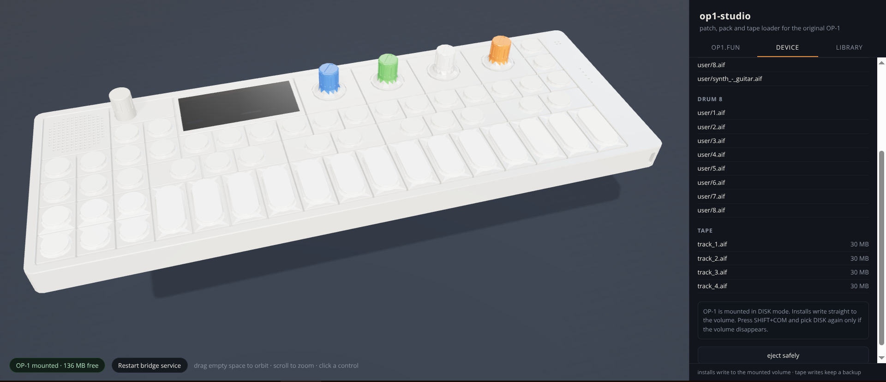

# OP-1 studio

A browser front end for a Teenage Engineering OP-1: the real CAD shell rendered in
three.js, keys you can click and drag, and a small local proxy that installs
patches, packs and tapes onto a mounted OP-1.



The screenshot above is live: 1920x831, an OP-1 in DISK mode with eight synth
patches, eight drum kits, four tape tracks and both album sides listed, the
bottom bar reading "OP-1 mounted · 136 MB free".

## Quick start

```sh
PYTHONPATH=src python3 -m op1_studio.server --port 8770
# then open http://127.0.0.1:8770/
```

or

```sh
python3 scripts/serve.py --port 8770
```

The proxy is stdlib only (`ThreadingHTTPServer`), binds loopback, and serves the
client from `src/op1_studio/client/`. Static files go out with
`Cache-Control: no-store`, so a reload always picks up edited modules.

Pass `--mount /path/to/OP-1` to point at a device mount you already have, or
`--data-dir` to move the library root. Without a mount the UI still renders and
the panel works; only the install endpoints report no device.

## What works

- Panel geometry from `assets/op1.stl` (3.59 MB, parsed by the vendored
  `STLLoader`), cut into individually pickable parts.
- Raycast picking, encoder drag, key press, mode switching, tape mode, patch
  install from the browse panel.
- **Restart bridge service**: the button in the bottom stage bar POSTs
  `/api/restart`, and the proxy reloads the code now on disk in place
  (`execve`, same port, same PID, about half a second of downtime). No unit
  file or supervisor is needed. The client waits for `/api/health` to report a
  fresh uptime and then refreshes the device status.
- `window.op1studio` exposes `{ state, api, scene, camera, controls, renderer,
  op1, enterMode, restartBridge }` for scripting and comparison shots.

Routes: `/api/health`, `/api/restart`, `/api/status`, `/api/library`,
`/api/op1fun/patches`, `/api/op1fun/pack`, `/api/upload`,
`/api/op1fun/install`, `/api/pack/install`, `/api/install/local`,
`/api/tape/install`, `/api/eject`.

## Panel truth

Panel 282 x 102 x 32 mm, corner radius 7 mm, aspect 2.74 to 2.75. Positions,
radii and band layout are written down in `docs/HANDOFF_THREEJS.md` and encoded
in `src/op1_studio/client/src/layout.js`. `layout.js` is the source of truth; the
mesh code follows it.

## Tests

```sh
PYTHONPATH=src python3 -m pytest -q     # 40 passed
```

## Reference assets

- `refs/3d_cad/teenage-engineering-op-1-2.snapshot.7/OP-1a.jpg` - the main
  reference photo for the project.
- `refs/print/white/` - three white-balanced panel plates (2048x2048) plus a
  contact sheet, produced by `tools/whiten_photos.py --lift 1.0 --knee 0.62`. The
  yellowed plastic tint is measured per plate and divided out in linear light, so
  the background stays pure white and the print keeps its hues. See
  `refs/print/white/README.md` for the method and the measured gains.

The CAD is Teenage Engineering's published OP-1 geometry. It is here as a local
reference; it is not covered by this project's licence, and the heavy neutral
formats (`.stp`, `.ipt`, `.iam`, `.zip`) are kept out of git for that reason.

## Known gaps

- Key and mode labels are not yet baked onto the panel faces. The scanned
  replacement caps and `tools/extract_labels.py` (glyph isolation on a 600 dpi
  flatbed scan) are in place, but the extraction is not clean enough to ship.
