# OP-1 Manual 1.2 Final

- source: `54b7f9bf8681400300255cab_original.pdf`
- pages: 49
- figures: `figures/` (one file per picture, named by page)

Text and figures are interleaved in the order they appear on the page, so
a paragraph about the display is followed by the display.

Only bitmap art is extracted here. Diagrams and display mock-ups drawn as
vector lines are not images in the PDF at all, so they survive only in the
page renders:

```
python3 tools/pdf_manual.py render refs/manual_pdf/<manual>.pdf --pages 21
```

## p1 - VERSION 1.2

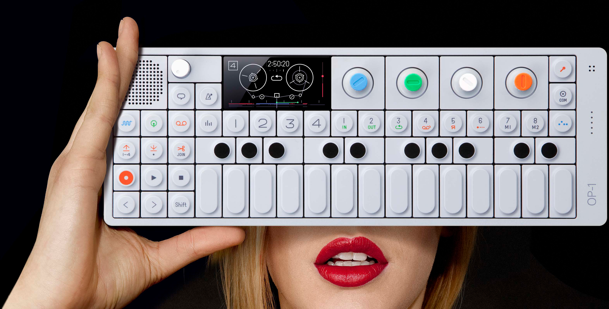

VERSION 1.2

## p2 - Warnings & Important Notes

Warnings 
Warranty & FCC

Warnings & Important Notes

FCC ID: Z23TE2A1

Before connecting this unit to other devices, turn off 
the power to all units. This will help prevent 
malfunctions and/or damage to speakers or other 
devices. If you need to connect/disconnect wires 
during use, ALWAYS make sure to connect the cable 
to the OP-1 first. Never connect the 3.5mm plugs 
going from the OP-1‘s mic input or line output to a 
mic input on a sound card with phantom power 
active. This could destroy the ports on the OP-1. Be 
sure to charge the unit using only 5V USB power, 
such as that from the USB ports of a computer, or by 
using a dedicated USB charger. Make sure you 
always have the OP-1 placed so it is level and sure to 
remain stable. Never install or use the unit in any of 
the following locations:

IC: 9915A-TE2A1
This device complies with Part 15 of the FCC Rules. 
Operation is subject to the following two conditions: 
(1) this device may not cause harmful interference, 
and (2) this device must accept any interference 
received, including interference that may cause 
undesired operation.

This device complies with Industry Canada licence-
exempt RSS standard(s). Operation is subject to the 
following two conditions: (1) this device may not 
cause interference, and (2) this device must accept 
any interference, including interference that may 
cause undesired operation of the device.

FCC NOTE:
This equipment has been tested and found to comply 
with the limits for a Class B digital device, pursuant to 
Part 15 of the FCC Rules. These limits are designed to 
provide reasonable protection against harmful 
interference in a residential installation. This 
equipment generates, uses and can radiate radio 
frequency energy and, if not installed and used in 
accordance with the instructions, may cause harmful 
interference to radio communications. However, 
there is no guarantee that interference will not occur 
in a particular installation. If this equipment does 
cause harmful interference to radio or television 
reception, which can be determined by turning the 
equipment off and on, the user is encouraged to try 
to correct the interference by one or more of the 
following measures:

• Humid environments or baths and washrooms. 
• Safety-critical applications. 
• Nuclear facilities and weapons systems. 
• Aerospace applications or environments for 
automotive installations.

Store small parts out of the reach of children and 
infants. If accidentally swallowed, contact a doctor 
immediately.

Warranty and return policy

The OP-1 is fully factory tested and comes with a 12 
month (from purchase date) warranty. This does not 
include malfunction due to misuse of the device, 
such as being dropped, crushed or used in an 
application of inappropriate voltages to the device’s 
connectors or improperly designed or executed 
modifications. In particular, you are the sole 
responsible for damage caused by a charging 
method other than 5V USB power. The general 
warranty policy does not cover ESD (static discharge) 
damaged products due to improper handling.

• Reorient or relocate the receiving antenna
• Increase the separation between the equipment 
and receiver.
• Connect the equipment into an outlet on a circuit 
different from that to which the receiver is 
connected.
• Consult the dealer or an experienced radio/TV 
technician for help.

The warranty does not cover shipping charges.

The manufacturer is not responsible for any radio or 
TV interference caused by unauthorized modifications 
to this equipment. Such modifications could void the 
user's authority to operate the equipment.

Make sure to read the Terms & Conditions here:
http://teenageengineering.com/terms-and-conditions

## p3 - OP-1 Operator’s Manual

TOC

OP-1 Operator’s Manual

7 
Sequencers
7.1 
Sequencers - Introduction
7.2 
Selecting a Sequencer Type
7.3 
ENDLESS Sequencer
7.4 
ENDLESS Functionality
7.5 
PATTERN Sequencer
7.6 
PATTERN Functionality
7.7 
TOMBOLA Sequencer
7.8 
TOMBOLA Functionality
7.9 
FINGER Sequencer
7.10 
FINGER Functionality

運営マニュアル

Benutzerhandbuch
Mode d’Emploi

©2010-2012 Teenage Engineering. All rights 
reserved.

Table of Contents

1 
Hardware - Overview
1.1 
Power On/Off
1.2 
Charging the Battery
1.3 
In- and Outputs
1.4 
OP-1 Side View

8 
Tape Mode
8.1 
Tape Mode - Introduction
8.2 
Record To Tape
8.3 
Overdubbing
8.4 
Rewind And Fast Forward
8.5 
Jump To the Start of Tape
8.6 
Jump To the End of Tape
8.7 
Reverse Playback
8.8 
Recording Level
8.9 
Tape Editing
8.10 
Advanced LIFT
8.11 
Changing Tape Speed
8.12 
Advanced Recording Techniques
8.13 
Tape Tricks
8.14 
Erasing Tape
8.15 
Backing Up Your Tape
8.16 
Bars

2 
Layout
2.1 
Keys and Knobs
2.2 
LEDs

3 
Musical Keyboard
3.1 
Playing a Sound
3.2 
Octave Shift

4 
Main Modes
4.1 
The Four Main Modes
4.2 
Using SHIFT + Any Main Mode
4.3 
Main Mode Screen Examples

9 
The Mixer
9.1 
Mixer - Introduction
9.2 
Sound Path
9.3 
Mixer
9.4 
EQ
9.5 
Master Effect
9.6 
Master Out

5 
Synthesizer Mode
5.1 
Synthesizer Mode - Introduction
5.2 
Synthesizer Engines
5.3 
Envelope
5.4 
Play Mode
5.5 
Synthesizer Effect
5.6 
Synthesizer LFO
5.7 
Change Sound
5.8 
Saving a Sound
5.9 
Sound File Structure

10 
Tempo
10.1 
Tempo - Introduction
10.2 
Setting the Tempo/Tap Tempo
10.3 
Using the Metronome
10.4 
Free Mode
10.5 
Beat Match
10.6 
Sync Mode

6 
Drum Mode
6.1 
Drum Mode - Introduction
6.2 
DRUM Sampler Engine
6.3 
Laying Out A Drum Kit
6.4 
Dynamic Envelope
6.5 
Importing Your Own Sounds
6.6 
Using OP-1’s Standard Layout
6.6 
DBOX Drum Engine

## p4 - 11 

TOC

(Continued)

11 
Help
11.1 
The Help Button
11.2 
Tools
11.3 
Battery Level

16 
Exercises
16.1 
Recreating Sounds
16.2 
Starting Out
16.3 
Helicopter Sound
16.4 
Singing Birds Sound

12 
Recording External Sources
12.1 
Using the Mic/Input Key 
12.2 
Mic/Input Key in Synth Mode
12.3 
Mic/Input Key in Tape Mode
12.4 
Sampling Using The Built in Microphone
12.5 
Creating a Drum Kit From FM Radio Waves

17 
Reference
17.1 
Synth Engines
17.2 
Effects Reference

18 
Hardware

13 
Song Rendering and Connectivity
13.1 
Album
13.2 
COM
13.3 
OP-1 Mode
13.4 
CTRL (Controller) Mode
13.5 
DISK Mode
13.6 
OPT (Option) Mode
13.7 
Sequencing External Equipment
13.8 
Controlling Ableton Live
13.81 Mac OS X Install
13.82 Windows Install
13.83 Finalize
13.84 Ableton Live Key Assignments
13.9 
Controlling Propellerhead Reason

14 
SHIFT Key
14.1 
SHIFT Key
14.2 
Change a Single Module
14.3 
SHIFT + Main Mode Keys
14.4 
SHIFT + Arrow Keys
14.5 
SHIFT + Encoders

15 
LFO Reference
15.1 
Element LFO Mode
15.2 
Random LFO Mode
15.3 
Tremolo LFO Mode
15.4 
Value LFO Mode
15.5 
The MIDI LFO Mode
15.6 
Crank LFO Mode
15.7 
Bend LFO Mode
15.8 
Additional Symbols Used in LFO Mode

## p5 - Dear user,

Introduction

Dear user,

Quick Guide Overlay

Thank you for choosing the OP-1 musical instrument. 
This device is precision made to last many years and 
designed to be practical, intuitive and to give you 
hours of creative pleasure. To get the most out of 
your new OP-1, be sure to read this operator’s 
manual carefully. For even deeper understanding and 
the latest pro tips, please visit the OP-1 community 
website http://ohpeewon.com

The OP-1 comes with a transparent overlay for quick 
reference of the keyboard layout. Keep this for future 
reference.

- Teenage Engineering

About this manual

Rubber bands

This manual is written more or less with one chapter 
for every key you find on your OP-1 (except the 
musical keyboard which counts as one).
You create sounds (using the Synthesizer or Drum 
Mode keys) that you may also Sequence before you 
record to TAPE and finally MIX. You also have the 
option to record a final mix to ALBUM.

You may use the PaperFoam box in which your OP-1 
came delivered as a temporary storage box. Use the 
rubber bands to seal the box.

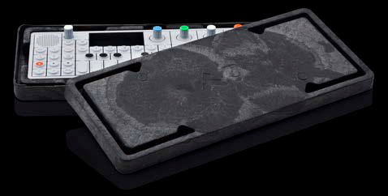


To make things easier, all keys, encoders and 
important modes relevant to the current page are 
marked on the OP-1 illustration in the page header.

Although the OP-1 is designed to be very intuitive, 
reading this manual will give you a deeper 
understanding of the concept behind many of OP-1’s 
functions and modes. Anyway, don’t be afraid of 
playing  around and exploring. You can always come 
back to this manual at a later stage.

USB Cable

The OP-1 uses a standard USB to mini USB cable for 
charging the OP-1 and for transferring data between 
your OP-1 and your computer.

What’s in the Box?

Check that the following items are included when 
you open the box: OP-1 Unit, USB Cable, Quick Guide 
Overlay and a Set of rubber bands.

If you want to use an external power adapter instead 
of a computer for charging the battery, make sure 
you are using a 5V USB standard charger. A 
dedicated charger works more efficiently and will 
charge the battery faster.

## p6 - Power on

Quick Guide

Power on

Using the mixer

First make sure that you have 
some recorded material on the 
tape.

Make sure that your OP-1 is fully charged. If not, 
insert the USB cable into the USB port located on the 
right side of your OP-1 and connect it to a computer 
or to a USB power adapter.

Press the MIXER key to open up 
the Mixer view. Now press the 
PLAY key to start playing the tape.

Turn on your OP-1 by sliding the white power switch 
located next to the USB port towards you. The 
Teenage Engineering symbol will be displayed briefly 
on screen. Turn up the volume using the white knob 
located on the left side of the screen (clockwise 
increases volume). You are now ready to play your 
new instrument.

Depending on which track that contains recorded 
material, the corresponding VU meter will indicate 
the sound level.

Adjust the individual track level by turning the color 
related knob.

Playing a synthesizer sound

Hold down the SHIFT key while turning the color 
related knob to adjust the PAN for each track.


Press the Synthesizer key. Select a 
synthesizer sound by pressing any 
key from 1-8. (These keys 1-8 are 
called Sound selection keys in this 
manual). Press any key on the 
Musical Keyboard.

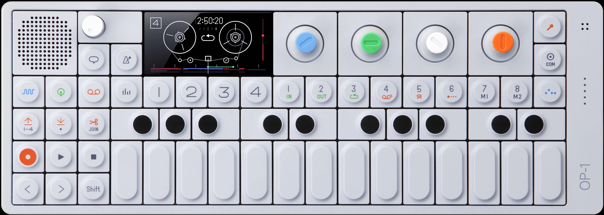

Congratulations! You have learned the basic 
fundamentals of your OP-1. To understand all of your 
OP-1’s functions, please read this operator’s manual 
carefully.


Playing a drum sound

Press the Drum key. Select a drum 
sound by pressing any Sound 
selection key from 1-8.  Press any 
key on the Musical Keyboard.

Recording to tape

Press the TAPE key. 
Select TRACK by pressing any of 
the 1-4 keys located under the 
screen. (These keys are called T1-
T4 in this manual). Press REC + 
PLAY to start rolling tape.

A good way to start is to follow the Quick guide 
printed on the plastic overlay that comes with your 
OP-1.

Play the Musical Keyboard. Use the STOP key to stop 
recording. Rewind to the starting point by pressing 
and holding the REWIND key. Now press PLAY to 
listen to your recording.

## p7 - 1 Hardware - Overview

1

Hardware Overview

1 Hardware - Overview
1.1 Power On/Off

NOTE: To adjust the input level press SHIFT + Mic 
key. To adjust the output level, turn the volume knob 
or set the master L/R level output located in mixer T4.

To power on your OP-1, slide the white power switch 
located on the right side of the device towards you. 
The display will light up and the OP-1 loads necessary 
system data.

1.4 OP-1 Side view

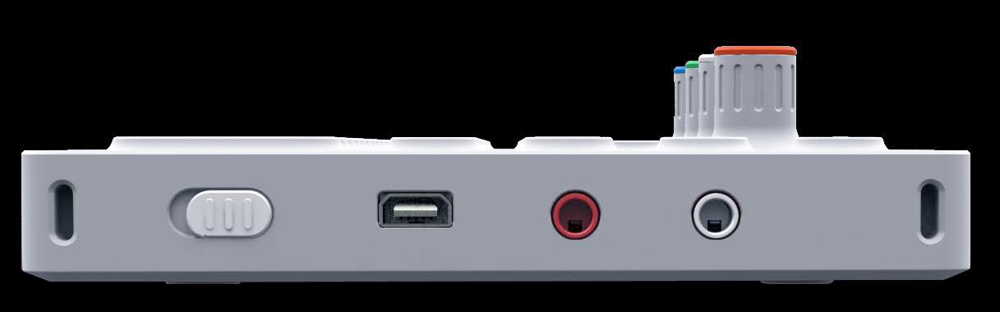

For strap

3.5 mm
Audio Out / Headphones

To power off, slide the power switch away from you. 
Data is always stored on-the-fly, so you don’t have to 
worry about saving your sound or recordings.

3.5 mm
Audio In

Everything will still be there the next time you power 
on your OP-1 exactly the same as when you left it.

NOTE: The more samples or other data you store on 
your OP-1, the longer the start-up process will be. It’s 
a good habit both for start-up time and for safety to 
back-up and clear your OP-1 occasionally.

USB for Charging the 
battery, for transferring 
files and for MIDI

1.2 Charging the Battery

Off

The first thing you should do is to connect your OP-1 
to a computer (or optional charger) via the USB port 
located on the right side of the unit. Make sure to 
keep your OP-1 connected until you have fully 
charged the internal battery. This will be indicated by 
the same LEDs used for the VU meter.

Power switch

On

For strap

To check the battery level, press the Help key. The 
LEDs will light up to indicate the level. Five lit LEDs is 
equal to a fully charged battery.


If you turn your OP-1 upside down, you will find 
symbols and braille text that indicates I/O location.

1.3 In and Outputs

OP-1 has three ports located on the right hand side of 
the unit.

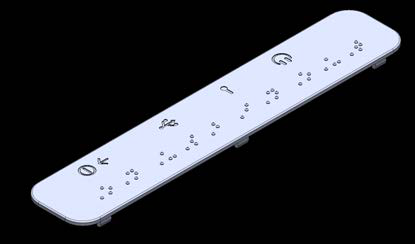

• Audio in/Line in
• Audio out for headphones/line out
• USB port for charging, transferring files and MIDI

## p8 - 2 Layout

2

Layout

2 Layout
2.1 Keys & knobs
The layout of the OP-1 is divided into different groups 
for easy reading and intuitive workflow.

The four color encoders are related to 
the graphical interface on the display.
A green graphical element or text hints 
that the green encoder will change its 
value or position.

Turn the Volume 
knob to set the 
master volume.

Speaker
Volume
Display
Color Coded Encoders


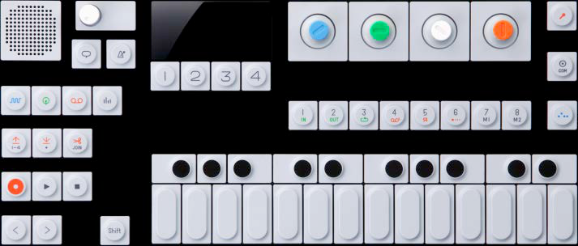

Mic / Input

Main Modes
Help
Tempo

Sound 1 - 8  /  Tape tricks

Album / Com

T1 - T4

Sequencer

Tape edits

Tape
Transport

Shift
Rewind / Forward
Octave shift +/-
Step Forward / Back

Musical Keyboard

2.2 LEDs

On the right side of your OP-1 you find the built in 
Microphone and VU/Battery LEDs

Built in
Microphone

VU/Battery

indicator


## p9 - 3 Musical Keyboard

3

Musical Keyboard

3 Musical Keyboard
3.1 Playing a Sound


Press any key on the musical keyboard and you 
should instantly hear a sound. If it is silent, turn
up the master volume located next to the speaker,
or press the Synthesizer or Drum key.


PRO-TIP: Press and hold HELP 
while playing the musical keyboard 
to let your OP-1 display the current 
note.

3.2 Octave shift


Use the Arrow keys to transpose 
octave while in Synthesizer or 
Drum mode.

NOTE: Before you start creating your first 
masterpiece, read this manual carefully to avoid 
deleting or over-recording your work.

## p10 - 4 Main Modes

4

Main Modes

4 Main Modes
4.1 The Four Main Modes

4.3 Main Modes Screen examples

Your OP-1 is designed to be easy to use, so the most 
important functions are located on the first keys to 
the left on the upper row. The four keys are grouped 
together and are called Main Modes.

Synthesizer using String Engine.


Drum using a sample

The four main modes are: Synthesizer, Drum, Tape 
and Mixer. Each key has a dedicated symbol and 
color to make it easy to navigate through the different 
screens and to find the appropriate key related to the 
currently active mode.

Example: All keys with orange symbols are related to 
the Tape because the tape symbol is orange.

4.2 Using SHIFT + any Main mode key

Tape

By pressing SHIFT + a Mode key you invoke special 
settings or functions for that mode. For Synthesizer 
and Drum you undo edits and tweaks that you made 
to the sound. For SHIFT + Tape you enter the Tape 
erase function.

Mixer

SHIFT + Mixer takes you to the Signal Flow screen

## p11 - 5 Synthesizer Mode

5

Synthesizer Mode

5 Synthesizer Mode
5.1 Synthesizer Mode – Introduction

5.2 Synthesizer Engines


The first module of a sound is its engine. This is the 
heart of the sound and is the most important part.

OP-1 has several original synthesizer engines. Each 
one has its own personality. When in Synthesizer 
Mode, the synthesizer engine’s visual is always 
located under T1 and is also the first screen that will 
show up when you change or select a sound.

It is possible to change an engine of a sound but 
keep the Envelope, the Effect and the LFO or G- force 
setting.

Each sound is built up from four modules located 
under the T1, T2, T3 and T4 keys, lined up under the 
display:

To do this, first select the Sound you want to change. 
Then use the T1 to T4 keys to select a specific 
module.


To change the Engine press SHIFT + T1. 
This opens the Browser screen, with the list 
of possible Engine choices:

FM – Frequency Modulation synthesis made easy. 
This is the type of engine that is found in the classic 
DX7 synthesizer.
Cluster – Up to six oscillators chained in a cluster.
Dr Wave – Raw 8-bit style engine.
Digital – Pure digital raw engine.
String – Physical modeling of a string instrument.
Pulse – Square wave engine.
Phase – Phase distortion type engine.

NOTE: The T1-T4 are soft keys, 
which means that in Synthesizer 
and Drum mode they function as 
described here. In Tape mode they 
are track keys T1-T4 and in Mixer 
Mode they are Mixer (T1), EQ (T2), 
Master Effect (T3) and Master Out/
Drive (T4).


Use the Blue encoder to scroll through the list and 
press T1 when your choice is highlighted to exit.

To enter Synthesizer Mode, press the key with the 
blue wave symbol on it. This enables both T1-T4 and 
sound selection keys 1-8.

More details on the different Synthesizer engines and 
their parameters are available in the Reference 
chapter.

When you have pressed the Synthesizer key, first 
select a sound from 1-8 with the Sound keys:


Then use T1-T4 keys to shape the sound:

T1 – Synthesizer engine
T2 – Envelope
T3 – Effect
T4 – LFO/G-force

Here follows a description of how a Sound is built up. 
For an in-depth description of all individual 
Synthesizer engines, the Envelope, Effects and LFO, 
please refer to the Reference chapter.

## p12 - 5.3 Envelope

5

Synthesizer Mode

(Continued)

5.3 Envelope

5.5 Synthesizer Effect

To shape the envelope, press the T2 key. 
The envelope controls the amplification of a 
sound and is triggered when a note is 
played. You can control the attack, decay, 
sustain and release. This is called an ADSR 
envelope.

To add an effect to a sound, press the T3 
key. You may toggle an effect on and off by 
pressing the T3 key a second time.

To change effect, press SHIFT + T3. This enters the 
effect browser screen. Use the Blue encoder to scroll 
through the list and press T2 to make your selection.

Use the four color encoders to shape the Envelope.


5.6 Synthesizer LFO

The LFO lets you modulate any Synthesizer Engine, 
Envelope or Effect parameter.

Blue – Attack, Green – Decay. White – Sustain. 
Orange – Release

To add an LFO to a sound, press the T4 key. 
You may toggle an LFO on and off by 
pressing the T4 key a second time.

This will be indicated by a color change in the 
graphical interface as soon as an encoder is turned.

To change LFO, press SHIFT + T4. This opens a 
browser screen, with the list of possible LFOs:

5.4 Play Mode

BEND – Lets you use the Bender accessory.
CRANK – Lets you use the Crank accessory.
ELEMENT – Lets you use external elements like the 
built in Microphone, Line in, G-force sensor or FM 
Radio to modulate a sound. Select the element, 
amount, destination and the destination parameter.
MIDI – Route external MIDI CC to the OP-1. 
RANDOM – randomize all parameters in a module. 
Set the speed, amount, LFO envelope and destination
TREMOLO – Lets you create different types of vibrato 
effects to your sound by modulating the pitch and 
volume. Set speed, pitch amount, volume amount 
and LFO envelope curve. The envelope curve applies 
an attack or decay curve to the speed of the LFO. 
VALUE – Use this classic LFO type to change one 
parameter only. Set amount, speed, destination and 
parameter.

To enter Play mode press SHIFT while you are in the 
Envelope screen which is located under the T2 key. In 
play mode, you can select if you want your sound to 
be Polyphonic, Monophonic, Legato or Unison.
In play mode, you also have the portamento 
parameter setting.

## p13 - NOTE: Turn the ENCODERS all the way for all options 

5

Synthesizer Mode

(Continued)

NOTE: Turn the ENCODERS all the way for all options 
under, for example, destination. The encoders click 
when turned, which doesn’t equal changing a value. 
Sometimes you need to turn a couple of clicks to 
change a value.

5.7 Changing Sounds

Consider sound selection keys 1-8 as your instant 
access keys. To change any of the sound 1-8 presets, 
press SHIFT + any key from 1 to 8 and a list of all 
available sound presets is shown. Select a preset by 
turning the Blue encoder for Engine type and Green 
Encoder for Preset choices.

Example: ELEMENT LFO

As described earlier the Element LFO uses different 
external elements to control any parameter of a 
Synthesizer engine, Envelope or Effect. Use the Blue 
encoder to select your source. The options are:

NOTE: The difference between changing just a 
Synthesizer Engine (SHIFT + T1) and a Sound (SHIFT 
+ 1-8) is that the later changes all four T1- T4 
settings.

G-force

5.8 Saving a Sound

To save a sound, you have two options:

Mic/Line/Radio

• DUMP TO TAPE – Use the LIFT key while in 
Synthesizer or Drum mode. Then switch to Tape, 
locate empty space on the tape and press the 
DROP key. The sound will now be converted to 
sound-data. To recall a sound that was dumped to 
Tape, press LIFT, switch to Synthesizer or Drum and 
press DROP.

G-force is pretty straightforward, you don’t need to 
make any further settings. When selecting option 
Mic/Line/Radio, you need to select the input source. 
Press SHIFT + Input key to select input and to adjust 
the gain. If Radio is selected here you may tune in to 
a radio station for satisfactory results.

• SAVE SOUND 1-8 – Tweak your sound on any of 
the sound slots from 1-8. Hold the sound key for 
five seconds. Sounds 1-8 are located in the 
SNAPSHOT folder located inside the Synth and 
Drum folders. Via USB, you may drag the sound 
you want to your desktop and rename it, or rename 
the sound inside the folder. Keep in mind that you 
may use names with a maximum of ten characters. 
Avoid uncommon symbols.

For more information about LFOs please refer to the 
LFO reference section of this manual.

PRO-TIP: You may create your own folder and place it 
in either Synth or Drum folder to organize your files.

## p14 - 5.9 Sound File structure

5

Synthesizer Mode

(Continued)

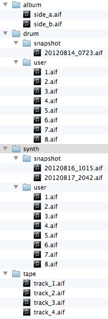

5.9 Sound File structure

The OP-1‘s storage allows you to add files for use for 
Synth and Drum sounds. It also lets you collect those 
files you have recorded in Tape and Album for use 
elsewhere. You may also manage your own presets, 
those which you have made in synth and saved. 
These are stored in the “snapshot” folders for Synth 
and Drum presets respectively, and default to a name 
containing their date of creation. Feel free to rename 
these, limiting the name to ten common characters.

When you connect your OP-1 to your computer and 
press SHIFT + COM key and select DISK mode the 
OP-1 shows up on your desktop:

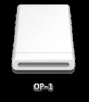

Double click the disk icon to reveal the internal OP-1 
files. All Sounds, Album recordings, Tape Tracks and 
snapshots show up as .aif files.

NOTE: Sound presets use a special OP-1 version of 
the .aif format, which includes BOTH a sound 
preview and synthesizer data. In other words, the 
OP-1 synthesizer engines are not sample based but 
modeled sounds.

## p15 - 6 Drum Mode

6

Drum Mode

6 Drum Mode
6.1 Drum Mode – Introduction

The basic concept here is to record all drums in a row 
and keep that recording to 12 seconds. Then set in 
and out points of that recording and dedicate it to a 
certain key on the musical keyboard.


The Drum Mode - entered by 
pressing the key with the green 
drum symbol - is similar to the 
synthesizer mode. The difference is 
it’s use for shorter drum/
percussion sounds.  Sounds can 
be loaded either into the Drum 
engine (DRUM), or made using a drum synth (DBOX).

6.3 Laying out a Drum Kit

To layout a Drum Kit, press any key on the musical 
keyboard and start to set the In point of the sound. 
This can be anywhere on the sample. Then set the 
Out point and hit the same key on the musical 
keyboard. You should now hear the part of the 
sampling you have dedicated to that key. The tools 
you have to set up your drum kit are:


As with Synthesizer mode, pressing the Drum key 
enables both T1-T4 and Sound selection keys 1-8.


When you have pressed the Drum key, first select a 
sound (drum-kit) from 1-8 with the Sound keys.

PITCH
Set the pitch of a part by turning the 
Blue encoder.

Then use T1-T4 keys to shape the sound:

DIRECTION
Press SHIFT and turn the Blue encoder 
to change direction of a part.


IN POINT
Set the in point by turning the Green 
encoder.

T1 – Drum engine
T2 – Dynamic Envelope
T3 – Effect
T4 – LFO/G-force

FINE TUNE IN POINT
Press SHIFT and turn the Green encoder 
to fine tune the position of the in point.

6.2 DRUM Sampler Engine

OUT POINT
Set the out point by turning the White 
encoder.

The difference compared to the Synthesizer sampler 
engine is that the Drum sampler has 12 seconds of 
recording time (vs. 6 seconds in the Synthesizer 
sampler) and has a layout function which lets you lay 
out parts of the sample to dedicated keys on the 
musical keyboard (compared to different pitch of the 
sound when playing the musical keyboard using the 
Synthesizer sampler).

FINE TUNE OUT POINT
Press SHIFT and turn the White encoder 
to fine tune the position of the out point.

PLAY TO END, LOOP, PLAY ONCE
Turn the Orange encoder to set the play 
mode of a part.

LEVEL
Press SHIFT and turn the Orange 
encoder to set the volume level of a part.

NOTE: Remember to always select the key on the 
musical keyboard where you want to change sound.

## p16 - 6.4 Dynamic Envelope

6
Drum Mode

(Continued)

6.4 Dynamic Envelope

PRO-TIP: A nice way of creating fill-ins, is to have the 
same sequence running and switching between 
drum kits based on the same sounds, but mapped 
differently. You can also map some keys to silent 
parts of a sample to “mute” certain sounds.

6.7 DBOX Drum Engine

Dynamic Envelope is specially designed for short 
drum sounds. Set the attack level with Blue Encoder, 
Mid part level with Green Encoder, Release Level with 
Encoder and use the Orange Encoder to adjust the 
region.

6.5 Importing your own sounds

Simply create a single sound file from whatever 
sounds you have chosen. Remember to keep the 
audio file maximum 12 seconds long. Then save the 
sound as an .aif file. Transfer the file to the User 
folder located inside the Drum folder. See chapters 
5.8-5.9 on how to transfer files to your OP-1.

DBOX, short for DRUMBOX, is a dual oscillator 
synthesizer, convenient for producing drum sounds. 
Blue encoder adjusts pitch, Green encoder adjusts 
waveform, White encoder adjusts envelope. Hold 
SHIFT to access secondary oscillator. Orange 
encoder is used for Cross Modulation and, when 
SHIFT is pressed, Filter cutoff frequency.

6.6 Using OP-1 standard layout

To make sound switching between kits more logical 
when you have a sequence running, it’s a good habit 
to layout your kits in the same order. The factory kits 
are mapped as seen at the bottom of this page.

Saving a sound is achieved by holding a Sound key 
(1-8) for five seconds, similar to elsewhere on the 
OP-1. The sound will be saved in Snapshot.


Snare Alternative

Kick Alternative

Crash cymbal

Closed Hi-hat

Ride cymbal

Open Hi-hat

Hand Clap

Bass 2

Bass 4


Tambourine

Rimshot

Bass 1

Bass 3

Bass 5

Snare

Kick

08

09

10

12

13

14

11

## p17 - 7 Sequencers

7

Sequencers

7 Sequencers
7.1 Sequencers – Introduction


OP-1 comes with four original 
sequencers that let you arrange 
notes in different ways. Both 
Synthesizer and Drum mode have 
their own dedicated sequencer 
memory and can have separate 
types active, even though only one 
can be played at a time.

7.4 Endless Sequencer Functions:

INSERT NOTES
To Insert a note, press SHIFT + any key on the 
musical keyboard. Keep holding down SHIFT until 
you are done with ALL notes you want to insert.

The big difference between the Tape and a Sequencer 
is that Tape produces a pure audio recording, while a 
Sequencer stores note data. One of the reasons for 
using a Sequencer is that you may change or alter 
the sound but continue playing the same stored 
notes.

INSERT LONG NOTES
Press SHIFT + any key on the Musical Keyboard. 
Continue to hold the keys while pressing the Forward 
Arrow key (>).

7.2 Selecting a Sequencer Type

INSERT SPACE
Press SHIFT + the Forward Arrow key (>).

TO DELETE LAST NOTE
Press SHIFT + the Rewind Arrow key (<).

To select Sequencer type press SHIFT + the 
sequencer key to enter the Sequencer Browser 
screen. Turn the Blue encoder to make your selection, 
then press the Sequencer key again to exit.

PLAY A SEQUENCE
To play a sequence just press any key on the Musical 
Keyboard. The pitch of the played notes will change 
depending on what key you press. This is called Key 
Transposition. To play the original pitch of the notes 
play the C key on the Musical Keyboard.


7.3 ENDLESS Sequencer

Endless is a very effective way to get sequencing 
done quickly. Just hold SHIFT + press any key on the 
musical keyboard to store a note. It automatically 
moves one step forward when you release the key.  
Hold SHIFT until you are done. Then release SHIFT 
and press any key on the musical keyboard to play 
your sequence. The maximum number of notes that 
can be stored is 99.


C

PLAY AND HOLD A SEQUENCE
Turn the Orange Encoder until HOLD lights up.

## p18 - CHANGE PLAYBACK DIRECTION OF A SEQUENCE

7

Sequencers

(Continued)

CHANGE PLAYBACK DIRECTION OF A SEQUENCE
You have three different options for how you want the 
notes to be played back. Forward, Reverse or 
Random. Change direction by holding SHIFT and turn 
the Orange Encoder.

NOTE: In Endless, you may use the arrow keys to 
change octave in playback mode.

7.5 PATTERN Sequencer

Pattern is a classic grid type sequencer found in 
many hardware and software instruments. This is a 
16 step sequencer, particularly useful for sequencing 
drum patterns.

SET NOTE LENGTH 
Note length is basically a way to define how many 
notes (beats) that will be played in one bar. This is 
related to the Master Tempo that you set in Tempo 
and to the bars in Tape mode. If you set 1/16, one bar 
in tape will be 16 notes or beats. Change note length 
by turning the Blue encoder.

SWING
Swing is a way to slightly alter the timing of notes 
played in a sequence. To add swing turn the Green 
encoder. No swing is a 50% setting.

7.6 Pattern Functions

INSERT NOTES
To Insert a note press SHIFT + any key on the 
Musical Keyboard. Keep holding down SHIFT until 
you are done with ALL notes you want to insert.

NOTE: Remember to check if you have applied swing 
when you record multiple layers of sequenced 
material to tape if you want them to be in absolute 
sync.

ERASING NOTE
Hold down SHIFT and turn the Blue encoder.

APPLY A PATTERN TO YOUR SEQUENCE
The Endless sequencer has a function which lets you 
add a pattern to your sequence. Turn the White 
Encoder to apply a pattern. A single dot means 
there’s no pattern applied. (turn the White encoder 
counter clockwise all the way until only a single dot is 
shown)

MOVING THE VERTICAL CURSOR LINE
Press Arrow keys or turn the Blue encoder to move 
the horizontal cursor line, by doing this you also 
select which note you want to focus on when 
erasing.

SWING
Swing is a way to slightly alter the timing of notes 
played in a sequence. To add swing turn the Green 
encoder. No swing is a 50% setting

NOTE: Remember to check if you have applied swing 
when you record multiple layers of sequenced 
material to tape if you want them to be in absolute 
sync.

ROTATE A PATTERN
By holding SHIFT + turning the White encoder, you 
can rotate the dots within the pattern.

ROTATE NOTES
Hold SHIFT + turn the Green encoder to rotate all 
notes. This might be good when you have entered 
the notes in Live Mode.

CRANK MODE
SHIFT + Blue encoder activates Crank mode, which 
gives you manual, music-box style playback control.

## p19 - LIVE MODE

7

Sequencers

(Continued)

LIVE MODE
Turn the Orange Encoder until HOLD lights up. The 
sequencer starts, and the white horizontal cursor 
moves across the sequence. Press SHIFT + any key 
on the Musical Keyboard to insert a note at the 
current cursor position.

7.7 TOMBOLA Sequencer

Use Tombola when you want to create a random 
sequence. Just throw a couple of notes into the 
Tombola and then set the gravity, mass and spinning 
speed. The harder/faster a note bounces the louder 
the sound will play.

LIVE EDIT MODE
Press SHIFT + any Arrow key while the sequencer is 
running to break the cursor connection and let you 
edit the notes as you would in normal stopped mode.

SET SEQUENCE LENGTH
Turn the White encoder to adjust the playback length 
of the sequence.

MOVE SECTION
If you hold SHIFT + turn the White encoder you may 
move the played back section around within the 
sequence. Great for fill-ins!

7.8 Tombola functions

DROP NOTES INTO TOMBOLA
Play any key on the Musical keyboard to drop a note 
into the Tombola.

PLAY AND HOLD A SEQUENCE
Turn the Orange Encoder until HOLD lights up.

ADJUST BOUNCINESS
Turn the Orange Encoder to adjust the bounciness of 
the notes. The harder a note hits the wall of the the 
Tombola the louder it will play. This is measured in 
amount of mass.

NOTE: To key transpose a Pattern sequence, switch 
to Synthesizer, Drum, Tape or Mixer mode and press 
any key on the Musical Keyboard. To play the original 
pitch of the sequenced notes, play the C key on the 
Musical Keyboard.


C

ADJUST HEAVINESS
This is measured in amount of Gravity. Turn the Green 
Encoder to set the gravity.

CHANGE PLAYBACK DIRECTION OF A SEQUENCE
You have three different options for how you want the 
notes to be played back. Forward, Reverse or Cycle. 
Change direction by holding SHIFT and turn the 
Orange Encoder.

## p20 - RELEASING NOTES

7

Sequencers

(Continued)

RELEASING NOTES
Turn the White Encoder to open the Tombola and 
release the notes.

7.10 FINGER Functionality

When Finger is activated for Synth, two keyboard 
players appear. When used with Drum, there are two 
gorillas. Each sequence, activated by pushing a white 
key on the Musical Keyboard, is populated by crosses 
by default. Press and hold a key on the Musical 
Keyboard to commence playback. Depending on 
which playback mode you are using (chosen using 
SHIFT+Orange encoder), pushing a second key on 
the Musical Keyboard will now either layer a second 
pattern (JOIN), play when you release the previous 
one (REPLACE), or play fill ins (FILL IN). Using the 
Orange encoder allows you to turn HOLD playback 
mode on for Finger.

TOMBOLA SPEED
Turn the Blue Encoder to adjust the speed and the 
direction of rotation of the Tombola.

INSERT NOTES
To insert a note press SHIFT + any key on the Musical 
Keyboard.

CRANK MODE
Engage Crank using SHIFT + Blue encoder. You may 
now spin the Tombola by hand, just using Blue.

MOVING THE CURSOR AND ERASING NOTES
Blue encoder moves the box cursor inside the 
sequence. Hold down SHIFT and turn the Blue 
encoder to erase while moving the cursor.

PRO-TIP: Keep the Tombola open and set a high 
rotation speed. This creates a random type of echo 
effect.

SET SEQUENCE LENGTH
White encoder adjusts the length of a pattern.

7.9 FINGER Sequencer

SWING
To add swing turn the Green Encoder. No swing is a 
50% setting.

The Finger Sequencer lets you play two sequences in 
combination with one another. Finger works the 
same in Synth and Drum modes (animations differ).

NOTE: Remember to check if you have applied swing 
when you record multiple layers of sequenced 
material to tape if you want them to be in absolute 
sync.

Each white key on the Musical Keyboard represents a 
pattern. Each pattern is visualized as the top middle, 
checkered rows. Each checked row may be filled with 
either Synth notes or Drum triggers. You will 
recognize notes and trigs as the small white crosses. 
The Green dot represent the pattern’s swing setting.

## p21 - 8 Tape Mode

8

Tape Mode

8 Tape Mode
8.1 Tape – Introduction

6. Play the Musical Keyboard.
7. Press STOP when done.
8. Press Rewind (left arrow) to rewind the tape.
9. Press Play to listen to your recording.


Your OP-1 has a built in tape 
feature with 6 minutes of recording 
time (in normal tape speed and 
44.1 kHz/16 bits). It has 4 individual 
tracks. To enter the Tape Mode 
press the Tape key with the orange 
tape symbol on it.

8.3 Overdubbing

The Tape always overdubs if there’s recorded material 
on the same track. To avoid overdubbing, lift any pre-
recorded takes out from the tape location.

8.4 Rewind and Fast Forward

Use the arrow keys to rewind and fast-forward the 
playback of the tape.


8.5 Jump to the start of the tape

This mode changes the function of T1-T4 which now 
become track 1-4:

Press STOP + Left Arrow key to jump to the very 
beginning of the tape.


8.6 Jump to the end of the Tape

Press STOP + Right Arrow to jump to the end of the 
last take on the tape.

8.7 Reverse Playback

The Sound selection keys change into Tape Tricks 1-8:

To play the tape reverse you have two choices:


Press SHIFT + Play.
Press the Reverse Tape Tricks Key when the tape is 
rolling.

8.8 Recording Level

8.2 Record to tape

Turn the Orange encoder to set the recording level.

1. Select the sound which you want to record.
2. Press the Tape key to enter Tape Mode.
3. Select a track to record to by pressing any of the 
track keys T1-T4.
4. Set recording level with the Orange encoder. (This 
is also the main level for Synthesizer and Drum 
sounds).
5. Press REC + Play to start recording.

## p22 - 8.9 Tape Editing


8

Tape Mode
(Continued)

of the active one. You may repeatedly use Join to 
join multiple takes.

8.9 Tape Editing

REGION LIFT – Use the loop in and out points to 
define the part you want to lift.


8.10 Advanced LIFT

Besides recording, the tape can also be used as a 
sketchpad for creating layered sounds. Using the 
tape this way let’s you build up a sound layer by layer 
on all four tracks and lift it (use LIFT ALL to lift all 
tracks) and then drop it in either the Synthesizer 
sampler or Drum sampler.
You may also save a sound to tape by pressing LIFT 
in any of the Synthesizer or Drum sounds and then 
select Tape mode and press Drop. This creates a data 
recording of all parameters and/or samples on the 
active tape track. To recall the sound, lift it from tape 
and drop it back into any sound from 1-8. For this 
function to work, the take has to be exactly the same 
and an isolated take as it was when it was dropped.

First select the track you want to edit. Recorded 
material shows up as grey lines and is referred to as 
takes. When an active track has recorded material, 
the lines turn orange. To edit a take, use Scrub, 
Rewind, FF or press STOP to center it under the tape 
head:

8.11 Changing Tape Speed

A take turns blue when it’s in position and ready for 
editing or moving. These are the editing actions for 
an active take:

You may change the speed of the tape whenever you 
want, even during recording. To do this, turn the 
White encoder. If you hold down SHIFT and turn the 
White encoder the tape speed is changed in fixed 
steps. The sound quality changes in the same way as 
a real tape when changing speed – the faster the 
tape speed, the higher the quality of the recording.


SCRUB – Use Blue encoder to scrub though the 
tape.

SLIDE – Use SHIFT + Blue encoder to slide a take. 
You may slide a take until either of its start or end 
point interferes with another take.

8.12 Advanced Recording Techniques

LIFT – Press the Lift key (Arrow up) to lift a take. 
The take is now in the memory. To undo press the 
Drop Key to place it at the center of the tape head. 
You may repeatedly press the Drop key to paste 
multiple takes. The tape moves each time to the 
end of a dropped take. Lift is also used as a way to 
delete a take.

A quite special recording technique is to put the tape 
in Rec Arm mode and control the speed manually. To 
do this press SHIFT + Rec. You are now recording but 
the reels are still. To move the tape back and forth, 
turn the Blue encoder. Depending on how quick you 
turn the encoder the pitch of the recording will vary.
Another great recording trick is to turn the out-to-in 
function on, found under the Mic key. This let’s you 
record everything you hear to a selected track. This 
also works as a bounce recording function.

DROP – Use this as way to place the last take 
stored in memory.

SPLIT – This splits a take.

LIFT ALL – Hold down SHIFT + Lift to lift all tracks 
into memory.

A nice option for additional recording control is using 
the OP-1 accessory Crank. This will give you music-
box-style control over your Tape recording.

JOIN – Press SHIFT + Split to join takes. This 
function joins the next closest take on either side

## p23 - 8.13 Tape Tricks

8

Tape Mode
(Continued)


8.13 Tape Tricks

8.14 Erasing Tape

To completely erase the tape and all recorded 
material, press SHIFT + Tape key. For good reasons 
you have to press all T1-T4 keys to start the erasing 
process.


When in Tape (or Mixer mode) the sound selection 
keys 1-8 turns into Tape Tricks keys:
The Tape Tricks are shown under numbers 1-8.
Tape Tricks are a collection of functions made to 
interfere with the Tape or the Mixer in different ways. 
They are implemented to open up for live tweaks and 
quick key mixing effects.

LOOP IN – Sets the loop in point of the tape.

Once all keys are pressed there’s no way back. Your 
tape will be wiped forever.

LOOP OUT – This sets the loop out point.

LOOP TOGGLE – Toggles loop on and off.

BREAK – Stops the tape. If a loop is active it 
will continue in the background to keep the 
break in time.

REVERSE – Change direction of the tape.

CHOP – A tempo locked repeat type of 
effect.

NOTE: Connect your OP-1 to your computer and 
transfer the Tape if you want a backup or need to free 
up space.

MEMO 1 – Memorize any parameter in Tape 
or Mixer for instant recall. To use this, hold 
down the key and turn any encoder while in 
Tape or Mixer screen. Release key when 
done. Press the key again to instant recall 
the changed parameter. This is great for 
switching between different EQ settings or 
to turn up the effect level when the tape is 
running.

MEMO 2 – Memorize any parameter in Tape 
or Mixer for instant recall.

## p24 - 8.15 Backing up your Tape

8

Tape Mode
(Continued)

8.15 Backing up your Tape

To backup your tape, connect your OP-1 to your 
computer and press SHIFT + COM. Select Disk 
Mode. The OP-1 will show up on your desktop as a 
disk.

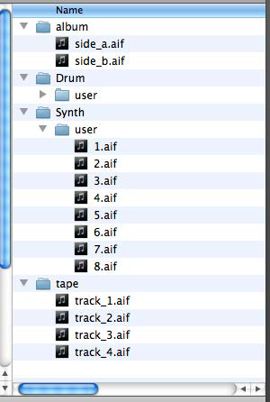


Locate the folder named “tape” and copy the files 
named “track_1.aif”, “track_2.aif”, “track_3.aif”, 
“track_4.aif”. Drag all track files to your computer’s 
desktop.


You have now made a backup of the Tape as four 
individual audio tracks.

NOTE: No Mix, EQ, Master effects or Drive will be 
applied to individual Tracks when exported. To make 
a final mix of your Tape, record to Album and backup 
the Album file. The album file will be located in 
Album, “SideA.aif” or “SideB.aif”

8.16 Bars

When Beat Match is selected in Master Tempo,
you’ll notice bar markers just above the tape tracks. 
One bar is 16 beats which means if you enter 16 
steps in the Endless step Sequencer and set it to 1/16 
and record it, it will fit exactly in one bar on the tape.

To jump from Bar to Bar, press SHIFT + Rewind (<) or 
SHIFT + FF (>)

## p25 - 9 Mixer

9

Mixer

9 Mixer
9.1 Mixer – Introduction

In the Mixer main screen, you adjust the individual 
level and Pan Left/Right of Tape tracks 1-4


Mixer is the final stage of the 
sound path. Its main function is to 
set the individual level and pan of 
the four tape tracks (T1), to adjust 
the master EQ (T2), add a master 
Effect (T3) and to add drive to your 
mix (T4). But as it is also the final 
destination for all sound, it should be worth noting 
how the sound travels inside your OP-1. This is called 
the Sound Path.

To adjust the level of a tape track turn any encoder to 
set the level from 0-99

Track 1 level – Blue encoder
Track 2 level – Green encoder
Track 3 level – White encoder
Track 4 level – Orange encoder

To set the Pan Left/Right

Hold SHIFT + turn the appropriate Encoder for the 
relevant Track, to adjust the Pan Left/Right.

9.2 Sound Path

The Sound Path is the way the sound moves from the 
moment you hit a key on the musical keyboard or 
press play on tape, until it reaches the speaker or line 
out. To help you keep an eye on this, there is a Sound 
Path screen in Mixer mode that you may check at 
anytime. To enter the Sound path screen, press 
SHIFT + Mixer key.

9.4 EQ

EQ means equalizer and is the word for a filter that 
let’s you adjust the low, mid and high frequencies of 
a sound. In the case of the Mixer, for the final mix. 
When the sound enters the EQ it comes as a mixed 
down stereo signal. (The stereo signal was just mixed 
down in the main Mixer screen).

Press T2 in Mixer mode to adjust the EQ:

NOTE: A warning symbol will light up when any 
critical level is set to zero.

9.3 Mixer

•Low (bass) – Turn the Blue encoder to adjust the 
low frequencies.

The mixer transforms the four Tape tracks into one 
stereo signal. To enter the mixer, press the Mixer key. 
Then press T1 to enter the mixer main screen.

•Mid – Turn the Green encoder to adjust the mid 
frequencies.

•High (treble) – Turn the Green encoder to adjust the 
higher (brighter) frequencies.

•EQ Amount – Turn the Orange encoder to adjust the 
overall EQ level. Turn counter clockwise for a clean 
signal with no EQ applied.

## p26 - 9.5 Master Effect

9

Mixer
(Continued)

9.5 Master Effect

RELEASE sets how quick the drive will narrow the 
difference between high and low audio levels, and at 
mid to long release times, you’ll start to notice the 
drive as a “pumping” sound.

Master effects are the same effects found in 
Synthesizer and Drum mode, but modified for stereo.

To add a master effect, press the T3 key. You may 
toggle an effect on and off by pressing the T3 key a 
second time.

You may also use drive to add texture and to make 
your final mix more dirty and raw.

PRO-TIP: Hold SHIFT while turning the Blue or Green 
encoder to adjust both LEFT and RIGHT at the same 
time.

To change the effect used, press SHIFT + T3. This 
enters the Master effect browser. Use Blue encoder 
to scroll through the list and press any key (except 
the musical keyboard) to make your selection.

9.6 Master Out

The master out screen is found under T4:

Here you adjust:

• The master balance Left/Right
• Add DRIVE
• Adjust the RELEASE of the Drive

DRIVE narrows the difference between high and low 
audio levels, and makes the output sound louder and 
more compact. At very high levels of drive, the audio 
starts to sound distorted.

## p27 - 10 Tempo

10

Tempo

10 Tempo
10.1 Tempo – Introduction

10.4 Free Mode

In Free mode the Tempo and Tape speed are 
independent of each other.


In Tempo, you set the master 
tempo for all sequencers. You can 
switch between Free, Beat Match 
and Sync modes, and you’ll also 
find the Metronome here.

10.5 Beat Match

Beat Match is a concept of keeping the Tempo and 
the Tape speed in sync. When Beat Match is turned 
on, (Turn the Green Encoder until Beat Match lights 
up) the current tempo is locked to the Tape speed 
and dimmed. This means that you now have to adjust 
the tape speed to change the tempo. If you turn Beat 
Match on and switch to Tape mode, you’ll notice that 
Bars have appeared above the tape tracks. These 
Bars are your guidelines when recording in sync. One 
bar is 16 beats long. Now, play a sequence and 
adjust the tape speed, you will hear the sequence 
play slower if you turn down the tape speed, and 
faster if you turn tape speed up. However, the pitch 
won’t change.

10.2 Setting the Tempo/Tap Tempo

This is the beauty of Beat Match, to have a drum beat 
playing using the sequencer and have recorded 
material played back from Tape in sync at the same 
time. Add some tape tricks to that and you have a 
nice live-tweaking set-up.

To set the tempo you have two choices:

• Turn the Blue encoder

• Tap the tempo – Do this by hitting the tempo key 
multiple times until you get the desired tempo.

PRO-TIP: Record different variations to single bars 
and use the arrow keys explained in the Bars section 
8.1-8.6 to easily move the playback loop between the 
variations.

10.3 Using the Metronome

To use the metronome, turn the Orange Encoder until 
you get your desired pitch. To start the metronome, 
press Play.

10.6 Sync Mode

Sync mode means the OP-1 is listening to whatever 
external tempo you may be feeding it via USB. This 
lets you slave tempo lock the OP-1 to MIDI Time 
Code (MTC) sent from external sequencers.

## p28 - 11 Help

11

Help & Tools

11 Help
11.1 The Help Button


Your OP-1 has a built-in Help function. Pressing the 
Help Key at anytime brings up a Speech Bubble 
which tells you what mode you are in and what 
Sound is selected. By holding down the Help Key and 
pressing any key you get the Key name and function 
of that specific key.

PRO-TIP: Hold down Help while playing the musical 
keyboard to get note information.

11.2 Tools

Press SHIFT + Help key to enter TOOLS. Here you set 
the time and date, and maybe you’ll find a calculator 
here in the future...

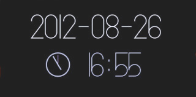

BLUE encoder – MONTH/YEAR
GREEN encoder – DAY
WHITE encoder – HOUR
ORANGE encoder – MINUTE

The Battery level is indicated by the LED 
array on the right side of your OP-1.
All LEDs lit (including the red) indicates a 
fully charged battery good for around 16 
hours of heavy use. The stand-by time is 
approximately 2 years.

11.3 Battery level


When you hold down the Help key 
you can check the battery level 
indicated by the VU/Battery meter 
located on the right side of your 
OP-1.

## p29 - 12 Recording External Sources

12

Mic/Input key

12 Recording External Sources
12.1 Using the Mic/Input Key

12.4 Sampling using the Built in Microphone

Press SYNTH
Press SHIFT + 1-8
Choose SAMPLER
Press 1-8
Press SHIFT+MIC
Choose microphone as input
Adjust gain and threshold settings, ORANGE+WHITE
Hold any key and speak into the microphone
Release key
Play the keyboard and enjoy the sound of your voice.


The Mic/Input key (with the 
microphone symbol on it) is used 
when you need to record any 
external audio.

The sources available for recording 
are:

• Line in
• Built-in Microphone
• Built-in Radio
• Output to Input (the ear symbol)

12.5 Creating a Drum Kit from FM Radio Waves

Press DRUM
Press SHIFT+1-8
Choose any sample based kit
Press 1-8
Press SHIFT+MIC
Choose FM radio for input using the Blue encoder 
and find a signal using the Green encoder.
Adjust gain and threshold settings using Orange and 
White encoders
Hold a key to start sampling
Release key
Play the keyboard and adjust start/stop positions 
using encoders.

The Mic/Input key works quite similar in any mode on 
the OP-1. Let us go through some of the Main Modes

IN MIXER MODE

12.2 Mic/Input Key in Synthesizer and Drum Mode

Same functionality as in Tape Mode.

Use the Mic/Input key when you have a Sampler 
engine selected to start to sample. Choose your 
desired source by turning the Blue Encoder. Use 
external audio to control the Element LFO

NOTE: To switch source in Tape or Mixer mode, press 
SHIFT + Mic/Input key. This let’s you switch sources 
and adjust the level.

12.3 Mic/Input Key in Tape Mode

PRO-TIP: Connect a 3.5 mm audio cable (or 
headphones) to Line in and use as an external 
antenna. (There is also an OP-1 antenna, sold 
separately).

Pressing the Mic/Input key in Tape mode lets you 
toggle external audio ON/OFF. This lets you mix in 
some radio playing in the background, or using 
what’s coming via Line In and mix that with your 
recorded material. (A great way to connect a second 
OP-1 and control sound levels of both units with one 
Master Volume Knob).

## p30 - 13 File Rendering and Transfer

13

Album/COM

13 File Rendering and Transfer
13.1 Album

13.3 OP-1 Mode

This is the mode which we’ve covered mostly so far, 
where your OP-1 works as a self contained, stand-
alone unit. Activating this mode is done from COM 
mode. Here press the OP-1 Key (T1) for getting to the 
standard OP-1 mode. In this mode, the OP-1 works as 
a stand-alone unit. When connected via USB in this 
mode, the OP-1 listens to and transmits MIDI-notes 
on MIDI channel 1 by default. This can be changed 
by using SHIFT + Blue Encoder.

The Album function lets you mix down all four tracks 
from Tape into stereo files saved to the OP-1. Album 
is useful when you want to record any Tape Tricks, 
EQ, effects or live jamming. You may also play the 
synthesizer simultaneously on top.

You have two sides of the record – Side A and Side B 
each have a recording time of 6 minutes. Just switch 
sides to record to the other side. The recordings will 
still be there if you Power off and back on. Remember 
to export a recordings over USB before you record to 
the same side a second time, as this will overwrite 
what was previously there.

13.4 Controller Mode

Controller Mode makes your OP-1 a MIDI controller 
keyboard. Use Shift + the encoders to set the 
behavior of the encoders and Arrow Keys. You may 
also switch MIDI channels by using SHIFT + Green 
encoder.

To record press the RECORD Key (T1) and then 
switch to Tape and press Play. When you are done 
switch back to Album and press STOP.

Knobs RELATIVE or 
ABSOLUTE

MIDI Channel

ARROW Keys behavior

The Album records directly from Master out, which 
means that any EQ, Master Effect or DRIVE you have 
added will be applied to the sound.

13.5 DISK Mode

13.2 COM

By pressing the DISK Key, your OP-1 turns into a 
storage device. It will show up on your computer’s 
desktop when connected via USB.

The Album key’s alternate use is to get to COM 
mode. You get there by pressing SHIFT + Album key. 
COM mode turns your OP-1 into a controller or 
storage device.


## p31 - 13.6 OPT Mode:

13

Album/COM

(Continued)

13.6 OPT Mode:

13.81 Mac OS X Install

The OPT Mode (OPTION Mode) 
disables USB charging of the OP-1, 
without having to pull the USB-
cord.

Right click the Live app icon (typically found in your 
Applications folder, inside the Live 8.x.x folder). Click 
”Show package contents”. Navigate to: ...Contents/
App-Resources/MIDI Remote Scripts.


OPT Mode is activated by pressing 
SHIFT+COM and then T4. From 
there, turn Blue encoder to toggle 
USB charging on/off. OPT Mode is useful when in a 
setup with a ground loop making noise. Regardless 
of this setting, your unit will still charge if powered 
off, or if it runs out of power, as long as it remains 
physically connected via USB.

Drop the OP1 folder into the MIDI Remote Scripts 
Folder.

13.82 Windows Install

Look for the MIDI Remote Scripts directory and drop 
the OP1 folder inside. If you are using Live 8.3, the 
default location will be any of the following:

13.7 Sequencing External Equipment

- Windows Vista and 7
C:\ProgramData\Ableton\Live 8\Resources\MIDI 
Remote Scripts.

Your OP-1 is always sending MIDI data out, even if 
you’re not in controller mode. This way you may 
connect the OP-1 via USB and use any of its built in 
sequencers for controlling software synthesizers or 
other connected hardware, configured to receive 
MIDI.

- Windows XP
C:\Documents and Settings\All Users\Application 
Data\Ableton\Live 8\Resources\MIDI Remote Scripts

13.83 Finalize

13.8 Controlling Ableton Live

Once installed pick the OP1 as Control Surface under 
the MIDI/Sync tab in Live’s preferences. Make sure 
OP1 MIDI Device is selected for both Input and 
Output.

OP-1 integrates as a configured control surface for 
Ableton Live. If you don’t plan on using OP-1 for 
controlling Live you might consider skipping this 
section.

Press SHIFT + COM and then put the OP-1 into CTRL 
Mode using T2.

Start by downloading, unzipping and installing the 
OP-1 Ableton Live script, available from the Teenage 
Engineering Library web (direct link).

## p32 - 13.84 Ableton Live Key Assignments

13

Album/COM

(Continued)

13.84 Ableton Live Key Assignments

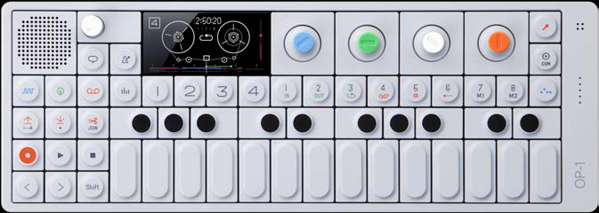

3
4
5
6
7

8
1
2

9
10
11

12
13
14
15
16
17
18
19
20
21
22
23
24
25

26
27
28

29
30
31

32
33
34

With the Ableton Live Script, your OP-1 is now 
integrated to run keys as numbered below. We are 
using four modes here as well, though very different 
as they correspond to Live’s functionality.

Global Assignments

# 
[Key Name]  
Function

1 
[Help]  
 
Tap Tempo
2 
[Metronome] 
Metronome
3 
[Blue]  
 
Select Track Volume
4 
[Green] 
 
Select Track Pan
5 
[White] 
 
Select Track Send 1
6 
[Orange] 
 
Select Track Send 2
7 
[Mic]  
 
Red Box Up
8 
[Album] 
 
Red Box Down
13 
[T1] 
 
 
Predetermined Bank Select
14 
[T2] 
 
 
User Bank 1 Select
15 
[T3] 
 
 
User Bank 2 Select
16 
[T4] 
 
 
User Bank 3 Select
17 
[Loop In] 
 
Punch In
18 
[Loop Out]  
Punch Out
19 
[Loop] 
 
Loop
20 
[Break] 
 
Overdub
21 
[Reverse] 
 
Select Track Mute
22 
[Chop] 
 
Select Track Solo
23 
[M1]  
 
Select Track Arm
24 
[M2]  
 
Reset Mute/Solo/Arm
25 
[Sequencer]  
Back To Arrangement
26 
[Lift]  
 
Open/Close Browser
27 
[Drop] 
 
Arrangement/Session Toggle
28 
[Split]  
 
Open/Close Detail
29 
[Rec]  
 
Record
30 
[Play]  
 
Play
31 
[Stop]  
 
Stop
32 
[REW] 
 
Red Box Left
33 
[FF] 
 
 
Red Box Right
34 
[Shift]  
 
Shift

Modes

9  [Synth] 
Perform Mode

Use arrow keys to shift octave and note keys to play, 
as usual.

10  [Drum] Clip Mode

- A red box will show you the area of clips you 
currently control. Use Keys 7/8 to move the red box 
up/down. Use keys 32/33 to move it left/right.
- Key notes are used for launching individual clips 
inside the red box. For stopping the clip, use SHIFT 
and press the same key again.
- Use last key note to trigger entire scene, and SHIFT 
+ note to stop all clips in the scene.

11  [Tape] 
Transport Mode

- Arrow keys move the current song position one 
beat.
- SHIFT + Arrow keys offset loop.
- Note keys are used to set the length of the loop. The

length increments are in multiples of two per key (1, 
2, 4, 8... 4096)
- SHIFT + Note key defines loop without changing

loop start.

12  [Mixer] Mixer Mode
- Arrow keys navigate on mixer tracks.
- Note keys select mixer tracks directly.

Please refer to Live’s documentation for an in-depth 
explanation of Live commands and navigation.

## p33 - 13.9 Controlling Propellerhead Reason

13

Album/COM

(Continued)

13.9 Controlling Propellerhead Reason

Following Reason 6.0.2 and Reason Essentials 1.0.2, 
the OP-1 has remote support built into Reason

With the OP-1 plugged and in and in MIDI Mode 
(Press SHIFT + COM, then press T2), open Reason’s 
Preferences. Navigate to Control Surfaces, and click 
Auto-detect Surfaces. Follow the instructions on the 
screen and close Preferences.

- Transport buttons control Reason’s record and

playback functions.
- Keyboard plays notes. 
- SHIFT + Arrow keys alter the octave.
- Tap Tempo sets tempo.
- Tape toggles looping on/off.
- Help button toggles metronome on/off.
- Selecting patches is done by using SYNTH and

DRUM keys, along with Sound selection keys 1-8
- Generally, the Reason integration with OP-1

operates off five main modes, starting with the 
Mixer key, which sets to Reason’s default mode, 
then T1 through T4 (for a total of five modes).
- Each of these Reason modes give different

functionality to both Encoders and Sound selection 
keys.
- SHIFT alters functionality of Encoders and keys

depending on the current Reason mode.
- Encoders: Green and White typically control filter

cutoff and resonance values. Orange will usually 
adjust volume, and Blue encoder will mostly control 
the mod wheel.
- When using a sampling Reason device, the Mic

button starts recording of the sample.

## p34 - 14 SHIFT Key

14

SHIFT Key

14 SHIFT Key
14.1 Using SHIFT

differences between (for example) SHIFT + Sound 1 
and SHIFT + T1.

Using SHIFT may not seem like a

14.3 SHIFT + Main Mode Keys


big thing to explain and dedicate a 
chapter to, but as it alternates a 
good portion of the OP-1’s keys, it’s 
well worth a look in addition of 
what has been covered already.

Using SHIFT along with the Synthesizer or Drum 
mode button will Recall the last saved version of a 
Synth or Drum sound. This is useful when you feel 
like improvising or trying out changes to a synth or a 
drum sound, yet still be able to Recall the sound of 
the original synth or drum.


The main reason to bring SHIFT up 
is its use in changing individual modules in 
Synthesizer and Drum mode.

Using SHIFT + Tape button lets you clear the 
recordings on tape. You will have a chance to confirm 
this before it happens.

14.2 Changing a Single Module

As we talked about in the Synthesizer and Drum 
chapters, pressing the T1-T4 keys lets you tweak the 
Engine, Sample kit, Envelope, Effect or LFO.

Using SHIFT + Mixer button gives you a view of the 
current signal path.


Recall Sound  Recall Sound     Erase Tape     Signal Path

So let’s say you have made settings for a perfect LFO 
and added a great Effect to that. The only thing that 
you want to change is the Engine. This is made 
possible by pressing SHIFT + T1. This command will 
replace just the Engine, while keeping the rest of the 
settings for the sound intact (LFO, Effect and 
Envelope settings which may be active for this 
particular sound). This can be useful in live settings. 
When you have a sequence running this command 
lets you hot swap the Engines of a sound, while 
keeping the same Effect and LFO. This method may 
allow for smoother transitions between Engines.

Of course, you still have the option of switching every 
building block of a particular sound, (including 
Engine, Envelope, Effects etcetera), by pressing 
SHIFT + Sound 1-8. This option will present you with 
the presets in green.

As an example of the difference between changing a 
complete sound and changing a single module, do 
take a second in Synthesizer mode to consider the

## p35 - 14.4 SHIFT + Arrow Keys


14

SHIFT Key
(Continued)

14.4 SHIFT + Arrow Keys

14.5 SHIFT + Encoders

In most modes the encoders have double functions. 
A couple of examples of the alternate encoder 
functions available with SHIFT include the following:

The Arrow keys functionality can be altered by SHIFT  
as follows:


While in Tape mode, SHIFT+ Green encoder lets you 
set the starting point of the loop, rather than the 
ending point which the Green encoder would control 
without SHIFT being pressed. Also in Tape mode, 
while holding shift and using the Orange encoder, the 
Tape volume is adjusted in smaller increments, 
compared to how the Orange encoder would affect 
volume without SHIFT pressed.

Tape stopped : 
Bar step back 
Bar step Forward

Tape looping:  
Move Loop back 
Move Loop Fwd

In Synthesizer: 
Pitch Bend Down 
Pitch Bend Up

Similarly, while editing individual hits in the Drum 
Sampler Engine, getting a more specific In Point and 
Out Point for a particular drum part, the SHIFT + 
Green encoder (In Point) along with SHIFT + White 
encoder (Out Point) can be used for fine tuning. 
Again, this means having the encoder make more 
exact changes while SHIFT is being held. In this 
manner SHIFT + encoder is also used for fine tuning 
of certain parameters. Looking at the same Drum 
Sampler Engine view however, the Orange encoder 
will alternate functions entirely when SHIFT is 
pressed. Using SHIFT + Orange encoder, you go from 
controlling play mode for a specific Drum Kit part, to 
controlling its sound level. Conversely, the orange 
graphics change from an arrow (indicating the type 
of play mode), to a number (indicating sound level).

## p36 - 15 LFO Modes

15

LFO Reference

15 LFO Modes

sets the destination for the LFO (you can aim it at 
Engine, Envelope, FX or Pitch & Volume). The 
Destination is then further defined using the White 
encoder. Orange encoder gets more specific, as this 
sets the Destination Parameter. Dimmed colors in the 
color wheel represent shifted encoders.

In the most basic understanding of how to use an 
LFO (Low-frequency oscillator), consider it an 
impulse to ”auto-tweak” your sound. A sound might 
seem good, but could get even better when you (for 
example) turn one of the encoders back and forth. 
With the help of an LFO, the behavior of that same 
encoder can typically be automated, or in some 
cases semi-automated. Sometimes the encoder itself 
won’t be spinning, yet you will still hear the changes 
the LFO produces on your sound. As far as visual 
feedback goes, a lot of the variations in sound will be 
viewable on the OP-1‘s display. To see the effect of 
some of the LFOs on a particular sound, consider 
looking at the details of the patch’s building blocks, 
using the T1-T3 buttons. The LFO of a sound, when 
active, will be found on T4. Please note that a few 
LFOs rely on some manual turning of the encoder to 
produce an oscillation. This involves the Crank and 
Bend LFOs.

15.2 Random LFO Mode

Random LFO modulates ALL parameters in a 
selected destination. It also have it’s own envelope 
curve to control attack and decay

Let’s start by loading an LFO to a sound, before we 
look at the specifics of each LFO Mode.

Blue encoder sets Amount. Green encoder sets 
speed. White sets Destination and Orange encoder 
sets the envelope Attack/Decay.

You access the LFO menu when you are on any 
DRUM or SYNTH sound (1-8), by pressing SHIFT+T4. 
Use the Blue encoder to highlight your selection. 
Press T4 to confirm which LFO you want to use for 
the current sound.

15.3 Tremolo LFO Mode

This LFO let you modulate the pitch and the Volume 
to create tremolo effects.

15.1 Element LFO Mode

The Element LFO uses external elements for 
modulating a sound.

Use the Blue encoder to choose between either the 
built-in G-Force sensor, or external input like Radio, 
Line-in or Mic.

If you selected external input, Press SHIFT + Mic key 
to set the input source.

Blue encoder sets Speed. Green encoder sets Pitch. 
White encoder sets Volume and Orange encoder sets 
the envelope Attack/Decay.

The Green encoder sets the Amount - this is how 
much the LFO will affect its target. The Blue encoder

## p37 - 15.4 Value LFO Mode

15

LFO Reference

(Continued)

15.4 Value LFO Mode

15.6 Crank LFO Mode

The Value LFO modulates one single parameter 
value. Blue encoder controls the speed and Green 
encoder the Amount. The White encoder sets 
Destination. Orange encoder sets destination 
Parameter. Dimmed colors in the color wheel 
represent shifted encoders.

The Crank LFO puts your hands in direct control over 
the LFO speed, by turning the Blue encoder. The 
White encoder sets destination, while the Green 
encoder controls the LFO amount. It should be worth 
mentioning that Crank mode is also supported in the 
Sequencers called Endless and Tombola. (Crank 
accessory sold separately).

15.5 MIDI LFO Mode

15.7 Bend LFO Mode

Another type of LFO is the MIDI LFO, which lets you 
receive external MIDI Control Change (MIDI CC) from 
other hardware, or from your computer’s music 
software. In this LFO Mode, the MIDI CC becomes 
the LFO. Setting up your OP-1 to receive MIDI CC for 
a particular sound is done by pressing SHIFT + T4 
from any SYNTH or DRUM patch.

The Bend LFO offers another take on physical control 
of the LFO, not unlike the Crank in the way it relies on 
manual control for oscillating. Orange encoder 
controls the LFO, White encoder sets the amount. 
Green and Blue controls destination. (Bend accessory 
sold separately).

PRO-TIP: Change Bend direction using SHIFT + 
Orange encoder.

MIDI CC can be sent from most music software like 
Ableton Live, Logic, Reason or Pro Tools. Depending 
on what software you’re using, make sure that you 
have MIDI playing on your computer, which is routed 
from the software to the OP-1, connected via USB.

Using the encoders in MIDI LFO, you may route up to 
four incoming channels of MIDI CC, and target them 
to your preferred destinations.

## p38 - 15.8 Additional Symbols Used in LFO Modes

15

LFO Reference

(Continued)

15.8 Additional Symbols Used in LFO Modes

The LFO clock found in the Tremolo and the Value 
LFO Modes indicate a tempo locked clock with 
numbers and a free running clock with hand.

15.9 Free LFO

In certain LFOs you’ll see the destination symbol 
followed by the letter “F”. This means that the LFO 
does not retrigger on every note played, when for 
example a sequencer is running. In this case the LFO 
is Free. A Free LFO combined with a slow clock 
allows for long sweeping effects.

## p39 - 16 Exercises

16

Exercises

16 Exercises
16.1 Recreating sounds

3. Set the Envelope to long attack by turning the 
Blue encoder until you get a sloped curve. Turn 
the Orange encoder counter clockwise to get a 
mid- to long release. Set both the Green and the 
White encoder to maximum by turning them 
clockwise.

A great way to learn how to model a sound on the 
OP-1 is to try to create a specific sound from real life. 
It might be a fat bass sound, a police siren or singing 
birds. The goal here is not to create a perfect ultra 
realistic replica, rather to learn how to combine 
different modules and understand their functions.

4. Enter the Effect screen by pressing the T3 key. 
Now set the effect to Punch by entering the Effect 
Browser (SHIFT + T3) and choose Punch from the 
list. Press any key to exit.

16.2 Starting out

Before you do the exercises here, remember to set all 
modules in the Mixer to clean settings and to turn off 
any sequencers:

5. The Punch Effect is great for adding punch to 
drums and final mixes, but also as a multi purpose 
resonance filter as used here. Set the Punch effect 
like this: Blue parameter to middle, Green to 
around 50-65, White to 24 and Orange to 99.

•Set all channels to around 80 and Pan to center (T1)
•Set the EQ to clean by turning the Orange encoder 
counter clockwise so the arrow points to CLEAN. 
(T2)
•Toggle any effect to OFF. (T3)
•Set master levels Left/Right to 99 and set Drive and 
Release to 0.
•Toggle any Sequencer to OFF.
•Enter Synthesizer mode by pressing the Synthesizer 
Key.

6. Now play a note on the musical keyboard and turn 
the Blue encoder simultaneously. You will now 
hear the noise going through the filter and when 
you turn the Blue encoder clockwise you open up 
the filter and let the sound through. The next step 
is to control the Blue parameter (equals to the 
Blue encoder) and make it automatically increase 
and decrease at a certain speed. This is done with 
the Parameter LFO.

16.3 Helicopter sound

Synthesizer engine: Digital
Envelope: Mid attack and long release
FX: Punch
LFO: Parameter LFO

7. Press T4 to enter the LFO screen and the Press 
SHIFT + T4 to enter the LFO browser and select 
Value from the list. Press any key to exit.

8. The Value LFO is made to modulate one 
parameter value only. To control the Blue 
Parameter in the Punch effect set Speed to mid 
(12 o’clock), Amount to 50-100, Destination to FX 
and Parameter to Blue.

Start by setting the Master Volume to a comfortable 
listening level.

1. Select any Sound (from 1-8) and press SHIFT + T1 
to enter the Synthesizer engine browser. Select 
Digital from the list and press any key to exit 
(except the musical keyboard). The Digital 
synthesizer engine is simple but very flexible and 
good for all-round synthesizer sounds.

9. Now play the musical keyboard and you should 
hear a helicopter type of sound.

If you now go back to the Effect screen you will 
actually see that the blue parameter is moving up and 
down. Try to turn the Blue encoder as you play a note 
and you will be able to set the range for the blue 
parameter to act within.

2. When in Synthesizer engine screen, turn any 
encoder until you get a noisy sound. To get a 
clean noise without any tone you need to set the 
Octave to +4. Do this by pressing > until the 
Octave pop-up says “Octave +4”.

## p40 - 16.4 Singing Birds sound

16

Exercises
(Continued)

16.4 Singing Birds sound

Synthesizer Engine: FM
Envelope: Short attack, short decay, low sustain and 
long release
Play Mode: Mono, Portamento: 60
FX: Spring
Sequencer: Tombola

To create a sound like singing birds, start with the FM 
engine which is good for metallic and distinct sounds 
but also clean sinus wave sounds when the FM level 
is turned down. Here we also use the Tombola to play 
the notes in a natural and random way and add some 
portamento to let the notes glide. Sometimes using a 
sequencer as tool for shaping a sound can be very 
useful.

1. Select any sound from 1-8 and change it’s engine 
to FM.

2. Turn the Blue encoder counter clockwise until you 
get a clean sinus wave sound.

3. Set the Octave to +3 (use arrow keys)
4. Set the Envelope to very short ATTACK, short 
DECAY, low SUSTAIN and mid RELEASE.

5. By pressing SHIFT in Envelope screen you enter 
the Play mode settings. Set PLAY MODE to 
MONO and PORTAMENTO to 60.

6. Choose the Spring effect and set the TONE to 
bright (white color), mid amount of TURNS, 
maximum DAMP and mid LEVEL.

7. Choose the TREMOLO LFO and set the SPEED to 
9 o’clock, PITCH to 20-30, VOLUME to 20-50 and 
ENVELOPE to straight.

8. Now press SHIFT + Sequencer key and select 
TOMBOLA. Press any key to exit.

9. Drop some notes into the Tombola and set the 
speed to 2.

As mentioned earlier, using a sequencer as one of the 
key elements can be very useful when creating   
melodic type of effects.

## p41 - 17 Reference

Reference

17 Reference
17.1 Synth engines

Cluster

Digital

TYPE
Multi Layered Oscillator Cluster

TYPE
True Digital Synthesis


Detune and

Number of 
waves (0-6)

Wave
Envelope
Spread
Unitor

Wave
Shaper
Octave

Ring Mod.

Digitalness

On/Off

Pulse

String

TYPE
Dual Pulsetrain Oscillator

TYPE
Waveguide String Model

Filter
Amplitude
Second

Tension
Impulse

Decay
Detune
Impulse

Pulse
Modulation

Type

## p42 - FM

Reference

Synth Engines

(Continued)

FM

Phase

TYPE
Four Operator FM Synthesis

TYPE
Phase Distortion


Topology
Freq.
FM
Amount
Detune

Phase

Distortion

Phase

Phase

Shift

Amount

Filter

Tilt

Dr Wave

Synthesizer Sampler engine

TYPE
Frequency Domain Synthesis

TYPE
Teenage Sample Player

Wave
Type &
Length

Filter
Phase
Chorus

Start
Loop In
Loop Out
End

Reverse

Loop In
Fine tune

Loop Out
Fine tune
Gain

On/Off

## p43 - Drum Sampler engine

Reference

Synth Engines

(Continued)

Drum Sampler engine

Drum Sampler engine

TYPE
Teenage Percussion Sample Player

TYPE
Teenage Percussion Sample Player


Note / Pitch
In
Out
Loop Off /
Once / On

Pitch
Waveform
Envelope
Cross 
Modulation

Reverse
On / Off

In
Fine tune

Out
Fine tune
Gain

Pitch
Waveform
Envelope
Filter Cutoff

Frequency

PRO-TIP: To copy a sample position across the 
keyboard in Drum mode, just hold the key you want 
to copy from and press LIFT, then hold the key you 
want to copy to and press DROP. This is good for re-
arranging your drum kits or creating tonal keys.

## p44 - 17.2 Effects Reference

Reference

Effects

17.2 Effects Reference

Delay

Grid

TYPE
Solid State Delay

TYPE
Three Dimensional Feedback Plate


Size
Speed
Feedback
Mix

X Size
Y Size
Z Feedback
Mix

Nitro

Phone

TYPE
Dual Resonant Turbo Filter

TYPE
Hacked Telephone System

Filter 
Frequency

Frequency

Resonance
Frequency

Tone
Phonic
Baud
Telematic

Follow

## p45 - Punch

Reference

Effects
(Continued)

Punch

Spring

TYPE
Hard Hitting Low Pass Filter

TYPE
Mathematic Reverb


Frequency
Punch
Rounds
Power

Tone
Turns
Damping
Send

PRO-TIP: Press and hold SHIFT while turning 
encoders for fine tuning of effects parameters.

## p46 - 18 Hardware

Hardware

18 Hardware

Mechanical

Body

CPU

• Low profile keyboard module
• Scissor-switch ultra low profile design
• Expected lifespan of 10 million 
keystrokes per key

• Advanced CNC:d one-piece Aluminum 
design.
• 2 X M6 Mounting holes for accessories.
• 2 X Cuts for strap accessory.

• 400 MHz Processor Core (800 MMACS 
performance)
• 64 MB Low-Power SDRAM (12ns)
• 512 MB NAND Flash storage
• 24-bit 96kHz ADC/DAC

Encoders

Color

• Industrial Grade Incremental Encoders
• Rotational life: Up to 1,000,000 
revolutions
• Excellent indexing feel (remains 
consistent over life)
• Zinc die cast and fiber enforced high 
performance plastic
• Used in Avionics Operating temperature 
range: -40 to +85°C2.8

• Light grey powder coated body and 
EDM textured keyboard

Battery

• Li-Ion 1800 mAh
• 16 hours active Battery Life
• 2 Years stand-by time
• Charge via USB port

Dimensions

• L  282 mm
• H 102 mm
• D 13.5 mm

I/O

Packaging

• USB 2.0 high speed (OTG)
• 3.5 mm Line Input, Output
• Built-in microphone
• High output mini speaker 8 Ohm 1 Watt
• 3-axis accelerometer (G-force) sensor
• Worldwide FM band support (64-108 
MHz)

• Paperfoam material
• Environmentally friendly

Motion Sensor

• 3 Axis Motion sensor (G-Force)
• Assignable to any synth, envelope, 
effect parameter or to pitch

Display

• AMOLED display running at 60 fps
• 320 x 160 pixel resolution
• Color Depth: 16.7 M
• Contrast: 10000:1 (good for outdoor 
use)
• Viewing Angle: 170°
• Life Time: 30,000 h
• 1800 mAh li-ion Polymer Battery

## p47 - OP-1 with optional Studio System rig.

OP-1 with optional Studio System rig.

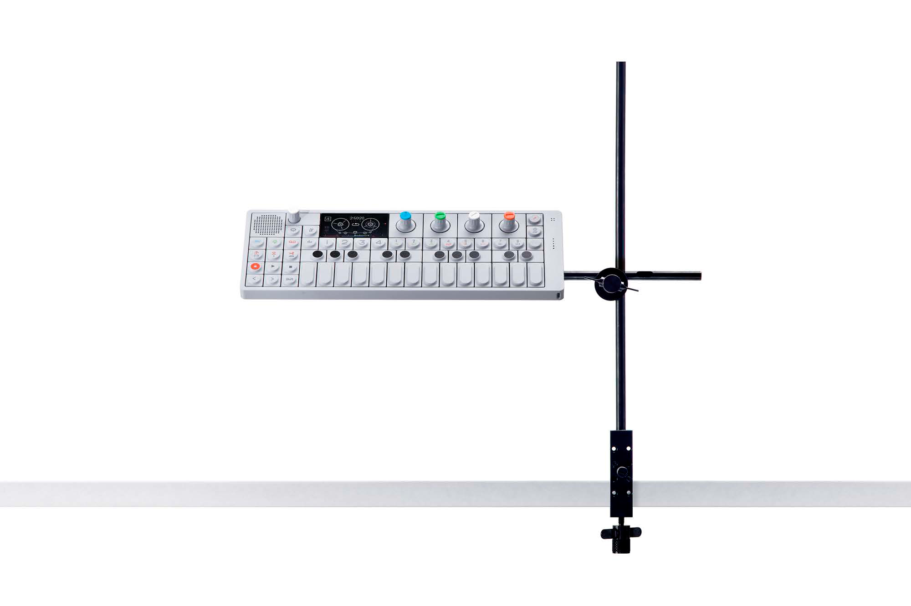

## p48 - OP-1 with optional accessories.

OP-1 with optional accessories.

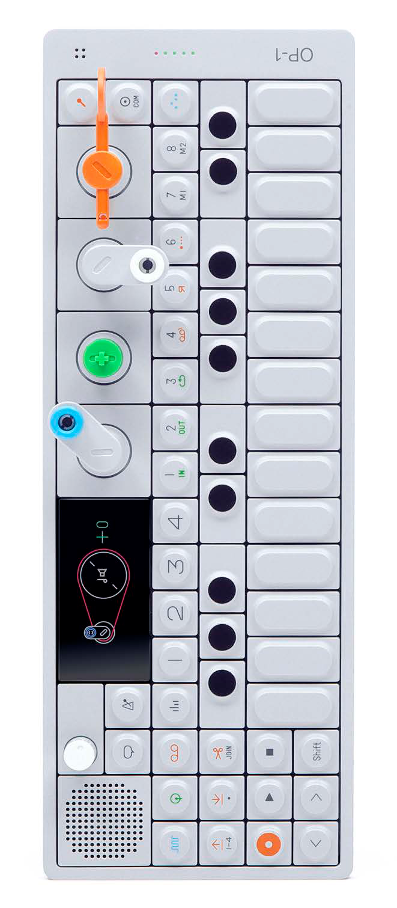

## p49 - page 49

_(no text on this page)_
